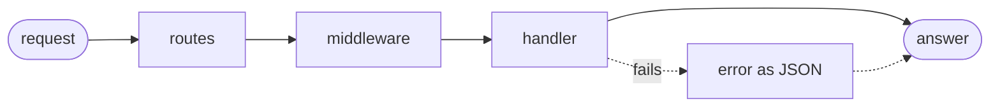

# Plod

*Takes its time, not yours.*

[](https://http-arena.com/#type=experimental&tuned=0)
[](https://http-arena.com/#scope=h2&type=experimental&tuned=0)
[](https://http-arena.com/#scope=ws&type=experimental&tuned=0)
[](https://http-arena.com/#scope=h3&type=experimental&tuned=0)
[](https://discord.gg/397eZdbnsR)

Plod is a REST framework for [Goose](https://github.com/aardappel/goose), built on
[goose-http](https://github.com/kaitk/goose-http). It follows Actix's model, adapted to
Goose, with no overhead over a hand-written router wherever the language allows.
An optional generator writes types, JSON readers and writers, and a router from an
OpenAPI document. Its mascot is Ari (genus [Ariolimax](https://en.wikipedia.org/wiki/Banana_slug)), a banana slug.

**The API isn't final.** Goose is still evolving, and Plod follows it: a feature such as
the [proposed coroutines](https://github.com/bitspittle/goose/blob/suspend-fn-proposal/docs/design/suspend_fn.md)
could change how routes are written. Larger redesigns like that will come together, in
a major version.

Plod is ready to try out and build prototypes with, but not yet for production: the
batteries a production service needs, such as database integration, are still to come.

[Tutorial](docs/tutorial/README.md) · [Best practices](docs/best-practices/README.md) ·
[Reference](docs/reference.md) ·
[Generator](docs/generator.md) · [Benchmarks](docs/benchmarks.md) ·
[Architecture](docs/architecture.md) · [Development](docs/development.md) ·
[Changelog](CHANGELOG.md) · [Packages](#packages)

Questions and ideas are welcome in
[Plod's channel](https://discord.com/channels/1559977219663732797/1563955365249425458)
on the Goose Discord.

Plod follows the
[half-sync/half-async](https://www.dre.vanderbilt.edu/~schmidt/PDF/PLoP-95.pdf) model,
meaning [**routes should never block their worker**](#routes-dont-block).

## Status

Plod builds wherever goose-http does: Linux, macOS, and Windows. Its examples also
pass their tests on arm64 Linux. It provides:

- **Routes and scopes**: path parameters, 404, 405, and `OPTIONS`, and prefixes with
  their own middleware ([reference](docs/reference.md#1-context-and-routes)).
- **Extractors**: path, query, header, and cookie parameters, JSON, URL-encoded and
  multipart forms, and your own types ([reference](docs/reference.md#3-extractors)).
- **Work that waits**: jobs on lanes, with the route resumed at the reply
  ([tutorial](docs/tutorial/11-waiting.md)), and goose-http's
  [HTTP client](https://github.com/kaitk/goose-http/blob/main/docs/api.md#an-http-client)
  on a lane.
- **Errors** as JSON, in your own format, or as RFC 9457
  ([reference](docs/reference.md#5-errors)).
- **Bodies and responses of any size**, in pieces as they arrive or are sent, files
  with ranges and conditional requests, and SSE
  ([reference](docs/reference.md#4-later-calls)).
- **Middleware**, inlined into the handler: CORS; bearer tokens, Basic, API keys, and
  cookies, JWTs signed with HS256 in a header or a cookie, and role checks;
  Server-Timing and an access log, security headers, compression (gzip, deflate,
  zstd), and any
  `inline fn` of your own that takes a block
  ([reference](docs/reference.md#2-middleware)).
- **WebSocket and HTTPS**, in optional modules: TLS 1.3, with h2 or HTTP/1.1 by ALPN
  ([reference](docs/reference.md#13-https)).
- **OpenAPI 3.1 in**: types, readers, writers, and a router
  ([generator](docs/generator.md)).
- **Testing** with `plod::serve_one`, without a socket
  ([reference](docs/reference.md#6-testing)).

Planned:

- Database integration, over goose-postgres and goose-sqlite.
- An OpenAPI document from the routes.
- JWTs signed with RS256 and ES256, and JWKS.
- Sessions and rate limiting. Until then, read cookies with `plod::cookie`, and rely
  on goose-http's per-connection limits.
- HTTP/3 for routes that wait. It works today for routes that answer at once.

## Packages

Plod and its optional modules use these Goose packages, each in a repository of its own:

| Package | What it does | Used by |
|---|---|---|
| [goose-http](https://github.com/kaitk/goose-http) | The server: HTTP/1.1 and h2, a loop per worker, lanes, and mail between threads | Plod itself |
| [goose-tls](https://github.com/kaitk/goose-tls) | A TLS 1.3 server in Goose, and a client, over OpenSSL 3 | `plod.tls` |
| [goose-acme](https://github.com/kaitk/goose-acme) | Certificates from Let's Encrypt or any ACME CA, through TLS-ALPN-01 | HTTPS without a proxy |
| [goose-compress](https://github.com/kaitk/goose-compress) | gzip, deflate, and zstd encoders, whole or streamed | `plod.compression` |
| [goose-hash](https://github.com/kaitk/goose-hash) | SHA-1, SHA-256, HMAC, PBKDF2, and secure random bytes | `plod.websocket`'s handshake, and `plod.jwt` |
| [goose-postgres](https://github.com/kaitk/goose-postgres) | The PostgreSQL protocol, with pipelined queries and no I/O of its own | A lane's database |
| [goose-sqlite](https://github.com/kaitk/goose-sqlite) | SQLite, built from the amalgamation it carries | A lane's database, or a route's |

## Quick start

Install Goose [`v2026.3`](https://github.com/aardappel/goose/releases/tag/v2026.3): unpack
the archive for your platform and put its directory on `PATH`
([Goose's install notes](https://github.com/aardappel/goose#install-a-release)). Building
a program also needs a C compiler and, on Linux, liburing:

- **Linux:** gcc or clang, with `libc6-dev` and `liburing-dev` (Debian, Ubuntu).
- **macOS:** the Xcode command line tools (`xcode-select --install`).
- **Windows:** the Visual Studio 2022 or later Build Tools, with the C++ workload.

Save this as `hello.goose`:

```rust
import http from "github.com/kaitk/goose-http@v0.5.12";
import plod from "github.com/kaitk/plod@v0.5.9";

fn handle(cx) {
    plod::routes(cx) { cx =>
        plod::get(cx, "/hello/:name") { plod::text(cx, 200, str("Hello, ", plod::param(cx, "name"))); };
    };
}

thread_fn worker(cfg: http::Config) {
    let e = plod::serve(cfg) { cx => handle(cx) };
    http::report(e);
}

fn main() {
    http::run(http::Config { port: 8080, .. }, worker);
}
```

Build and run it, then open <http://localhost:8080/hello/goose>:

```sh
goose build hello.goose
./hello
```

*Note: a server with workers needs `goose build`: `goose hello.goose` runs through
TinyCC, which can't start threads.*

**With a schema**, describe the API in OpenAPI 3.1 using JSON or
[TypeScript](docs/generator.md#2-write-it-in-typescript), then
[generate its types and router](docs/generator.md#1-run-it). `api::dispatch(cx)` replaces
the routes and calls your handler for each operation with typed, validated parameters
and a validated body: [tutorial, page 5](docs/tutorial/05-schema.md).

The examples are complete programs to start from, each tested over HTTP:

| Example | What it shows |
|---|---|
| [`plain/`](examples/plain/main.goose) | Routes, scopes, extractors, and middleware, without a schema |
| [`schema/`](examples/schema/) | A generated router and types, with hand-written handlers |
| [`compress/`](examples/compress/main.goose) | Compressed answers, whole and in pieces |
| [`upgrade/`](examples/upgrade/main.goose) | A 101 and an echo of the client's bytes |
| [`websocket/`](examples/websocket/main.goose) | A WebSocket echo |
| [`device/`](examples/device/) | A board's API: sysfs readings, a firmware upload, a token, and CORS |

## Concepts



- **Routes are code.** Goose has no function values to store in a table, so a route is a
  call that matches a method and a path and runs its block, `plod::get(cx, "/p") { ... }`,
  a scope is a block that owns a prefix, `plod::scope(cx, "/v1") { ... }`, and a
  generated router uses a `match`. Unmatched requests receive 404, 405, or an
  `OPTIONS` response
  ([routes](docs/reference.md#1-context-and-routes)).
- **One context.** Every call takes `cx`: the request, the response being written,
  worker state, and request state.
- **Middleware is a block** around the routes it applies to. It compiles into the
  handler, so a layer adds no function call ([middleware](docs/reference.md#2-middleware)).
- **Errors return to the route.** A failure anywhere within a route ends it with a JSON
  error in a customizable format ([errors](docs/reference.md#5-errors)).
- **Workers share nothing and never block** ([below](#routes-dont-block)). Each lane
  takes an enum of its jobs, so a job sent to the wrong lane doesn't compile, and a
  job's error fails its route.
- **An abort ends the process**, in a worker or a lane. Run the server under systemd,
  Docker, or Kubernetes, which restarts it
  ([goose-http](https://github.com/kaitk/goose-http/blob/main/docs/patterns.md#a-crash-ends-the-process)).

For differences from Actix and the reasons behind them, see the
[architecture](docs/architecture.md#actix-and-where-plod-differs).

### Routes don't block

A worker is one thread serving thousands of connections, so while a route runs, the
worker's other connections wait. A 20 ms query inside a route holds up all of them for
20 ms. Plod therefore splits a server in two, the half-sync/half-async pattern:

- **Workers** are the asynchronous half. They run routes, which parse, check, look up,
  and answer. Short CPU work, including a query on embedded SQLite, stays here.
- **Lanes** are the synchronous half: threads that run plain blocking code, such as a
  database driver, a call to another service, or a long computation. A route sends a
  lane a job with `plod::ask` and returns. The worker serves other connections, and
  calls the route again when the reply arrives.

[Work that waits](docs/tutorial/11-waiting.md) makes that move one step at a time.
[Lanes and jobs](docs/best-practices/lanes.md) shows how to give each kind of slow work
a lane of its own ([6.1](docs/best-practices/lanes.md#61-a-lane-for-each-kind-of-slow-work)),
keep long CPU work off the workers
([6.3](docs/best-practices/lanes.md#63-long-cpu-work-goes-to-a-lane)), and choose
which work is refused under load
([6.4](docs/best-practices/lanes.md#64-choosing-which-work-is-refused-under-load)).

## Benchmarks

*Slow by name only.*

Measured on Plod `v0.5.9`, goose-http `v0.5.12`,
and Goose `v2026.3`. The machine: a Ryzen 7 5800X3D running Ubuntu under WSL2,
4 workers per server, with wrk as the client.
[All results, the method, and the losses](docs/benchmarks.md).

Every framework serves the same REST APIs through its own router, extractors, and
middleware.

- **A**, **B**, and **C** are HttpArena's items, a time tracker, and a clinic's records,
  with larger, more deeply nested JSON from A to C.
- **Templates** builds each record's JSON once at startup.
- **F**, **R**, and **M** measure the framework itself: one route, 203 routes, and A
  behind CORS, a bearer token, and `Server-Timing`.

| Workload | Plod | Aegon (C++) | dusty (Zig) | viltrum (V) | actix-web |
|---|:---|---:|---:|---:|---:|
| [A](docs/benchmarks.md#the-tiers): items, 0.2 KB | **567k req/s** (98%) | 513k | 374k | 229k | 276k |
| [B](docs/benchmarks.md#the-tiers): time entries, 0.3-13 KB | **301k req/s** (101%) | 287k | 166k | 51.0k | 149k |
| [C](docs/benchmarks.md#the-tiers): records, up to 728 KB | **59.4k req/s** (98%) | 54.0k | 24.6k | 2.3k | 32.5k |
| C, templates | **145k req/s** (99%) | 117k | 138k | 11.4k | 97.3k |
| [F](docs/benchmarks.md#the-tiers): one route | 472k req/s (97%) | **512k** | 395k | 381k | 278k |
| [R](docs/benchmarks.md#the-tiers): 203 routes | 454k req/s | **497k** | 359k | 330k | 148k |
| [M](docs/benchmarks.md#the-tiers): A with middleware | **498k req/s** | 402k | 343k | 216k | 227k |
| [Uploads](docs/benchmarks.md#uploads-and-memory): up to 8 MB | 1,103 req/s (99%) | [fails](docs/benchmarks.md#failed-checks) | **1,230** | [fails](docs/benchmarks.md#failed-checks) | 1,201 |
| [Peak RSS](docs/benchmarks.md#against-other-frameworks), the worst tier for each | **109 MB**, uploads beside forms | 644 MB, C templates | 781 MB, uploads beside forms | 927 MB, B templates | 384 MB, C templates |

*Note: percentages, such as (98%), are Plod's share of goose-http's rate with no
framework.* Goose and viltrum ran on 2026-10-25, Aegon on 2026-10-19, and dusty and
actix-web on 2026-10-18, on the same machine. "Fails" marks a cell whose checks the framework
fails, which isn't measured.

Goose uses io_uring. Results for every server, both Goose event loops, and memory:
[docs/benchmarks.md](docs/benchmarks.md#against-other-frameworks).

## Prior art

Plod takes ideas and direct inspiration from these projects:

- **[Tina](https://github.com/pmbanugo/tina)**, a thread-per-core framework in Odin:
  the original design that goose-http grew from, and that Plod inherits. A loop per
  worker, and bounded boxes that carry jobs to lanes and replies back
  ([goose-http's credits](https://github.com/kaitk/goose-http#credits)).
- **[actix-web](https://github.com/actix/actix-web)**: the runtime's model. An `App` of
  scopes and routes, extractors chosen by type, and middleware around a group of
  routes.
- **[Elysia](https://github.com/elysiajs/elysia) 2**, its `kiana` branch, reviewed at
  `c91f61f` (2026-10-11): the generator's shape. One composed handler per route, with
  only the hooks it needs and the request parts it reads, inline validators, and a
  response writer that copies only declared fields. Goose's compiler does at build time
  what Elysia generates at run time or in its AOT build
  ([architecture](docs/architecture.md#the-generator)).
- **[Aegon](https://github.com/UdayKhare09/Aegon)**, a C++ framework: direct
  inspiration for much of Plod's API design, middleware, and feature set. Its guide
  served as the checklist for what a framework should offer. RFC 9457 errors, the
  security-header presets, and the shorter route declarations come from it, and so do
  the plans for JWT, more auth schemes, and a data layer.
- **[HttpArena](https://github.com/MDA2AV/HttpArena)** and its entries: smaller
  optimizations, each measured before it was taken.
  [viltrum](https://github.com/Tuntii/viltrum) (V) led goose-http to timers on the
  precise clock and timer tables that grow with use.

## License

Licensed under either of the [Apache License, Version 2.0](LICENSE-APACHE) or the
[MIT license](LICENSE-MIT), at your option. Unless you state otherwise, any
contribution you submit for inclusion, as defined in the Apache-2.0 license, is
licensed the same way, without any additional terms or conditions.
