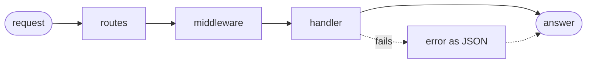

# Plod

*Takes its time, not yours.*

Plod is a REST framework for [Goose](https://github.com/aardappel/goose), built on
[goose-http](https://github.com/kaitk/goose-http). It follows Actix's model, adapted to
Goose, with no overhead over a hand-written router wherever the language allows.
An optional generator writes types, JSON readers and writers, and a router from an
OpenAPI document. Its mascot is Ari, a banana slug, and the name is a joke that the
[benchmarks](#benchmarks) explain.

The API is still taking shape. The tutorial and examples use the intended API, but
names and details may change between tags. Work is also underway to reduce the
remaining overhead over goose-http.

[Tutorial](docs/tutorial/README.md) · [Best practices](docs/best-practices/README.md) ·
[Reference](docs/reference.md) ·
[Generator](docs/generator.md) · [Benchmarks](docs/benchmarks.md) ·
[Architecture](docs/architecture.md) · [Development](docs/development.md) ·
[Changelog](CHANGELOG.md)

*Note: Plod was named goose-rest before `v0.4.0`. GitHub redirects `kaitk/goose-rest`
to `kaitk/plod`, so imports of earlier tags still build.*

## Status

Plod builds wherever goose-http does: Linux, macOS, and Windows. Its examples also
pass their tests on arm64 Linux.

🟢 works · 🟡 partial · ⚪ not yet · 🔴 out of scope

| | Feature | Notes |
|---|---|---|
| 🟢 | Routes | Path parameters, 404, 405, and `OPTIONS` ([reference](docs/reference.md#1-context-and-routes)). |
| 🟢 | Scopes | Prefixes, each with its own middleware. |
| 🟢 | Extractors | Path, query, header, and cookie parameters, JSON, and custom types ([reference](docs/reference.md#3-extractors)). |
| 🟢 | Forms | URL-encoded and multipart fields and files ([reference](docs/reference.md#3-extractors)). |
| 🟢 | State | Per worker in `cx.app`, per request in `cx.state`. |
| 🟢 | Middleware | Blocks inlined into the handler ([below](#middleware)). |
| 🟢 | Errors | JSON errors, a custom format, or RFC 9457 ([reference](docs/reference.md#5-errors)). |
| 🟢 | Async work | Work on other threads and lanes, resumed with the reply ([tutorial](docs/tutorial/11-waiting.md)). |
| 🟢 | Testing | `plod::serve_one` without a socket ([reference](docs/reference.md#6-testing)). |
| 🟢 | OpenAPI in | Types, readers, writers, and a router from OpenAPI 3.1 ([generator](docs/generator.md)). |
| ⚪ | OpenAPI out | A document from the routes. Planned. |
| 🟢 | Bodies in pieces | Any size, as it arrives, or gathered ([reference](docs/reference.md#4-later-calls)). |
| 🟢 | Files, streaming | Files with ranges and conditional requests, and responses in pieces, as for SSE ([reference](docs/reference.md#4-later-calls)). |
| 🟢 | WebSocket | An optional module ([reference](docs/reference.md#43-websocket)). |
| 🟢 | HTTPS | TLS 1.3, h2 or HTTP/1.1 by ALPN, and a context per connection, in an optional module ([reference](docs/reference.md#13-https)). |
| 🟡 | HTTP/3 | Off unless a listener asks, in an optional module; routes can't wait on it yet ([reference](docs/reference.md#13-https)). |
| 🟢 | HTTP client | goose-http's, from a lane ([its API](https://github.com/kaitk/goose-http/blob/main/docs/api.md#an-http-client)). |

### Middleware

| | Middleware | Notes |
|---|---|---|
| 🟢 | CORS | Preflight requests, allowed origins, and credentials. |
| 🟢 | Bearer tokens | 401 with `WWW-Authenticate`; passes the token to your verifier. |
| 🟢 | Server-Timing and access log | Combined middleware, or timing alone. |
| 🟢 | Your own | Any `inline fn` that takes a block ([reference](docs/reference.md#2-middleware)). |
| ⚪ | JWT | No built-in verifier; use your own with the bearer middleware. |
| ⚪ | Sessions | No session store yet; read cookies with `plod::cookie`. |
| 🟢 | Compression | gzip, deflate, and zstd according to `Accept-Encoding`, in an optional module, for answers written whole and responses sent in pieces; files go as they are ([reference](docs/reference.md#21-compression)). |
| ⚪ | Rate limiting | No limiter yet; goose-http's per-connection limits and timeouts apply. |
| 🟢 | Default headers | Security headers with HTML and API presets, prepared at setup and selected per request ([reference](docs/reference.md#22-security-headers)). |

## Quick start

Install Goose [`v2026.3`](https://github.com/aardappel/goose/releases/tag/v2026.3): unpack
the archive for your platform and put its directory on `PATH`
([Goose's install notes](https://github.com/aardappel/goose#install-a-release)). Building
a program also needs a C compiler and, on Linux, liburing:

- **Linux:** gcc or clang, with `libc6-dev` and `liburing-dev` (Debian, Ubuntu).
- **macOS:** the Xcode command line tools (`xcode-select --install`).
- **Windows:** the Visual Studio 2022 or later Build Tools, with the C++ workload.

Save this as `hello.goose`:

```rust
import http from "github.com/kaitk/goose-http@v0.5.12";
import plod from "github.com/kaitk/plod@v0.5.9";

fn handle(cx) {
    plod::routes(cx) { cx =>
        plod::get(cx, "/hello/:name") { plod::text(cx, 200, str("Hello, ", plod::param(cx, "name"))); };
    };
}

thread_fn worker(cfg: http::Config) {
    let e = plod::serve(cfg) { cx => handle(cx) };
    http::report(e);
}

fn main() {
    http::run(http::Config { port: 8080, .. }, worker);
}
```

Build and run it, then open <http://localhost:8080/hello/goose>:

```sh
goose build hello.goose
./hello
```

*Note: a server with workers needs `goose build`: `goose hello.goose` runs through
TinyCC, which can't start threads.*

**With a schema**, describe the API in OpenAPI 3.1 using JSON or
[TypeScript](docs/generator.md#2-write-it-in-typescript), then
[generate its types and router](docs/generator.md#1-run-it). `api::dispatch(cx)` replaces
the routes and calls your handler for each operation with typed, validated parameters
and a validated body: [tutorial, page 5](docs/tutorial/05-schema.md).

The [tutorial](docs/tutorial/README.md) builds a projects API a page at a time: the
basics first, then bodies and responses of any size, work that waits, and limits. The examples are complete
programs to start from, each built and tested with HTTP requests:

| Example | What it shows |
|---|---|
| [`plain/`](examples/plain/main.goose) | Without a schema: routes, scopes, extractors, a JSON or form body, middleware, and a 4 MB upload alongside the 1 MB default |
| [`schema/`](examples/schema/) | From `api.json`: generated types and router, hand-written handlers, and a 2 MB route limit set with `x-body-limit` |
| [`compress/`](examples/compress/main.goose) | Answers compressed according to `Accept-Encoding`, with the optional `plod.compression` module: goose-http's defaults, an export compressed as it's sent in pieces, and a scope with its own compression levels and no zstd |
| [`upgrade/`](examples/upgrade/main.goose) | An upgraded connection with `plod::upgrade`: a 101, then the client's bytes echoed back until the server closes the connection, or the client closes it first |
| [`websocket/`](examples/websocket/main.goose) | A WebSocket echo with the optional `plod.websocket` module: `plod::ws_upgrade` at the request, and each message back through `plod::ws_read` |
| [`device/`](examples/device/) | A board's API: sysfs readings, bounded settings, a firmware upload, a bearer token, and CORS, on one worker |

## Concepts



- **Routes are code.** Goose has no function values to store in a table, so a route is a
  call that matches a method and a path and runs its block, `plod::get(cx, "/p") { ... }`,
  a scope is a block that owns a prefix, `plod::scope(cx, "/v1") { ... }`, and a
  generated router uses a `match`. Unmatched requests receive 404, 405, or an
  `OPTIONS` response
  ([routes](docs/reference.md#1-context-and-routes)).
- **One context.** Every call takes `cx`: the request, the response being written,
  worker state, and request state.
- **Middleware is a block** around the routes it applies to. It compiles into the
  handler, so a layer adds no function call ([middleware](docs/reference.md#2-middleware)).
- **Errors return to the route.** A failure anywhere within a route ends it with a JSON
  error in a customizable format ([errors](docs/reference.md#5-errors)).
- **Workers share nothing and never block**, as in
  [goose-http](https://github.com/kaitk/goose-http#concepts). I/O-bound work, such as a
  query to a database server, runs on a lane, one or more threads of its own: the route
  sends it a
  [message](https://github.com/kaitk/goose-http/blob/main/docs/patterns.md#mail-between-threads)
  and resumes when the reply arrives, the half-sync/half-async pattern
  ([tutorial](docs/tutorial/11-waiting.md), [why](docs/architecture.md#waiting-on-a-lane)).
  Each lane takes an enum of its jobs, so a job sent to the wrong lane doesn't compile,
  and a job's error fails its route.
- **An abort ends the process**, in a worker or a lane. Run the server under systemd,
  Docker, or Kubernetes, which restarts it
  ([goose-http](https://github.com/kaitk/goose-http/blob/main/docs/patterns.md#a-crash-ends-the-process)).

For differences from Actix and the reasons behind them, see the
[architecture](docs/architecture.md#actix-and-where-plod-differs).

## Benchmarks

*Slow by name only.*

Measured on Plod `v0.2.1`, goose-http `v0.4.3`,
and Goose master `f114b5a`. The machine: a Ryzen 7 5800X3D running Ubuntu under WSL2,
4 workers per server, with wrk as the client.
[All results, the method, and the losses](docs/benchmarks.md).

Every framework serves the same REST APIs through its own router, extractors, and
middleware.

- **A**, **B**, and **C** are HttpArena's items, a time tracker, and a clinic's records,
  with larger, more deeply nested JSON from A to C.
- **Templates** builds each record's JSON once at startup.
- **F**, **R**, and **M** measure the framework itself: one route, 203 routes, and A
  behind CORS, a bearer token, and `Server-Timing`.

| Workload | Plod | Aegon (C++) | dusty (Zig) | actix-web | Axum |
|---|:---|---:|---:|---:|---:|
| [A](docs/benchmarks.md#the-tiers): items, 0.2 KB | **583k req/s** (99%) | 513k | 374k | 276k | 253k |
| [B](docs/benchmarks.md#the-tiers): time entries, 0.3-13 KB | **317k req/s** (100%) | 287k | 166k | 149k | 142k |
| [C](docs/benchmarks.md#the-tiers): records, up to 728 KB | **63.2k req/s** (100%) | 54.0k | 24.6k | 32.5k | 35.2k |
| C, templates | **155k req/s** (99%) | 117k | 138k | 97.3k | 92.4k |
| [F](docs/benchmarks.md#the-tiers): one route | 498k req/s (100%) | **512k** | 395k | 278k | 266k |
| [R](docs/benchmarks.md#the-tiers): 203 routes | 471k req/s | **497k** | 359k | 148k | 264k |
| [M](docs/benchmarks.md#the-tiers): A with middleware | **509k req/s** | 402k | 343k | 227k | 198k |
| [Uploads](docs/benchmarks.md#uploads-and-memory): up to 8 MB | 1,124 req/s (98%) | [fails](docs/benchmarks.md#failed-checks) | **1,230** | 1,201 | 1,168 |
| [Peak RSS](docs/benchmarks.md#against-other-frameworks), the worst tier for each | **123 MB**, uploads beside forms | 644 MB, C templates | 781 MB, uploads beside forms | 384 MB, C templates | 584 MB, C templates |

*Note: percentages, such as (98%), are Plod's share of goose-http's rate with no
framework.* Goose ran on 2026-10-20, Aegon on 2026-10-19, and dusty, actix-web, and
Axum on 2026-10-18, on the same machine. "Fails" marks a cell whose checks the framework
fails, which isn't measured.

Goose uses io_uring. Results for every server, both Goose event loops, and memory:
[docs/benchmarks.md](docs/benchmarks.md#against-other-frameworks).

## Credits

The runtime draws three ideas from [actix-web](https://github.com/actix/actix-web):

- An `App` of scopes and routes.
- Extractors chosen by type.
- Middleware around a group of routes.

The generator draws three ideas from Elysia 2, the `kiana` branch of
[Elysia](https://github.com/elysiajs/elysia), reviewed at `c91f61f` (2026-10-11):

- One composed handler per route, with only the hooks it needs and the request parts it
  reads.
- Inline validators.
- A response writer that copies only declared fields.

Goose's compiler does at build time what Elysia generates at run time or in its AOT build
([architecture](docs/architecture.md#the-generator)).
